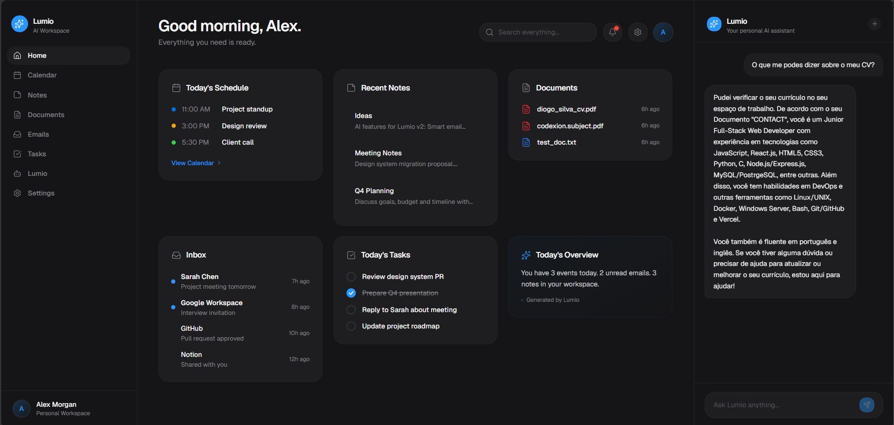
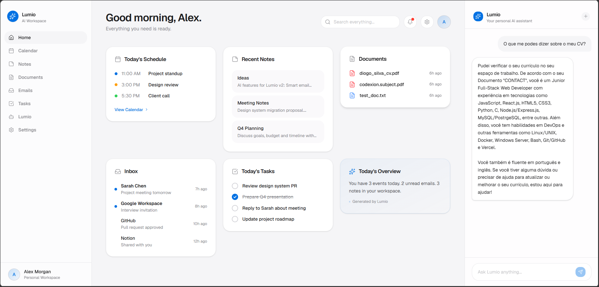

# Lumio

Your personal AI workspace: notes, documents, calendar and tasks in one place, with a RAG-powered assistant that answers questions about your own content.

> **Note:** this is a personal project and is still in development. You're welcome to use it, test it and, if you're interested, contribute with a PR.
>
> Lumio supports English and Portuguese. Retrieval uses **BM25** (keyword search), so a question written in a different language from the document may not find it: BM25 looks for the exact words of the question, not for similar meanings. Ask in the language of your files for best results.

Lumio brings your productivity tools together into one clean, Apple-inspired workspace. It centralizes your notes, documents, calendar and tasks, and pairs them with an assistant that answers questions, summarizes and helps you stay on top of your day.

[Watch Lumio here](https://sylvzzz.dev)

## Screenshots

| Dark | Light |
| --- | --- |
|  |  |

## Features

- **Notes, documents, calendar and tasks** in a single workspace, with a global search
- **AI assistant (RAG)** available as a side panel on every page and on its own page:
  - answers questions using your documents, notes, tasks and calendar
  - streams the answer as it is generated
  - shows which documents were used as sources
  - keeps your chat history
- **Documents**: upload `.pdf`, `.docx`, `.md` and `.txt` files, organize them in folders, preview and download them
- **Calendar**: create, edit and delete events, including all-day events and time zones
- **Tasks**: pending and completed lists
- **Google login** with an allow-list of authorized emails
- **Landing page** for visitors and an **onboarding** on first use
- **Settings**
  - Profile: name, age and gender
  - Appearance: light, dark or system theme
  - Language: Portuguese or English
  - API key: choose your provider (Groq, OpenAI or DeepSeek) and update your key at any time
- **Inbox**: placeholder page for now, email integration is not implemented yet

## How it works

```
Browser ──▶ nginx (HTTPS :443) ──┬──▶ React app (static :80)
                                  └──/api──▶ FastAPI (:8000) ──▶ PostgreSQL
                                                    │
                                                    ├──▶ BM25 index (per user, on disk)
                                                    └──▶ LLM provider (Groq / OpenAI / DeepSeek)
```

1. You sign in with Google. Only emails listed in `ALLOWED_EMAILS` are accepted.
2. Notes, tasks, events and chats are stored in **PostgreSQL**. Every query runs under **row-level security**, so each user only sees their own rows.
3. Uploaded documents are split into chunks and indexed with **BM25**. Each user has their own files and index, plus a small shared knowledge base about how to use Lumio.
4. When you ask the assistant something, the backend retrieves the most relevant chunks, adds a summary of your agenda, tasks, notes and documents, and sends everything to the LLM. The answer is streamed back (Server-Sent Events) together with its sources.

The AI features need an API key from a supported provider. Without one, the rest of the workspace keeps working.

## Tech stack

| Layer | Technology |
|---|---|
| Frontend | React 19, Vite, TypeScript, Tailwind CSS 4, shadcn/ui, Framer Motion, TanStack Query, React Router, Zustand |
| Backend | Python 3.12, FastAPI, Authlib (Google OAuth), psycopg |
| Database | PostgreSQL 15 with row-level security |
| Retrieval | BM25 (`bm25s`) with LangChain text splitters |
| AI | Any OpenAI-compatible API: Groq (default), OpenAI, DeepSeek |
| Infra | Docker Compose, nginx (HTTPS), Adminer, Terraform (Google Cloud VM) |

## Prerequisites

| Requirement | Install |
|---|---|
| Git | [git-scm.com](https://git-scm.com/downloads) |
| Make | `apt install make` |
| Docker + Docker Compose | [docs.docker.com](https://docs.docker.com/engine/install/) |
| Google OAuth credentials | [Google Cloud Console](https://console.cloud.google.com/apis/credentials) |
| LLM API key | [Groq](https://console.groq.com/keys) (free tier) or [OpenAI](https://platform.openai.com/api-keys) |

## Getting started

### 1. Clone

```bash
git clone https://github.com/sylvzzz/Lumio.git
cd Lumio
```

### 2. Create the database secrets

Docker Compose reads the database credentials from files in `secrets/`. Create one file per value (no trailing spaces) and choose your own passwords:

```bash
mkdir -p secrets
echo "lumio"            > secrets/db_name.txt
echo "lumio_user"        > secrets/db_user.txt
echo "admin"      > secrets/db_admin.txt
openssl rand -hex 16    > secrets/db_password.txt
openssl rand -hex 16    > secrets/db_admin_password.txt
openssl rand -hex 16    > secrets/db_root_password.txt
```

### 3. Configure the backend

```bash
cp backend/.env.example backend/.env
```

Then fill in `backend/.env`:

| Variable | Description |
|---|---|
| `GOOGLE_CLIENT_ID` / `GOOGLE_CLIENT_SECRET` | OAuth credentials from the Google Cloud Console |
| `OAUTH_REDIRECT_URI` | Must match the redirect URI registered in Google, e.g. `https://localhost/api/auth/callback` |
| `ALLOWED_EMAILS` | Comma-separated list of emails allowed to sign in (leave empty to allow every emaul)|
| `SESSION_SECRET` | Random string for signing sessions: `openssl rand -hex 32` |
| `LLM_BASE_URL` | OpenAI-compatible endpoint (default: Groq) |
| `LLM_MODEL` | Model name |
| `LLM_API_KEY` | Your provider key (can also be set later in **Settings → API Key**) |
| `LUMIO_TZ` | Optional. Time zone used for "today" in the assistant. Defaults to `Europe/Lisbon` |
| `DEV` | Optional. Set to `1` to allow session cookies over plain HTTP |

In the Google Cloud Console, add your `OAUTH_REDIRECT_URI` under **Authorized redirect URIs**.

### 4. Run

```bash
make app
```

This creates the data folders and runs `docker compose up -d --build`. Then open **https://localhost**.

The certificate is self-signed, so your browser will ask you to accept the exception.

## Commands

| Command | What it does |
|---|---|
| `make app` | Creates the data folders and starts all services in the background |
| `make stop` | Stops all services |
| `make restart` | Stops, rebuilds from scratch (`--no-cache`) and starts again |
| `make data` | Creates the local data folders (`lumio/data/postgres`, `lumio/data/backend`) |
| `make clean_data` | **Deletes** all local data (database and uploaded files) |
| `make install` | Creates a Python venv and installs backend and frontend dependencies (for development outside Docker) |

## Services

| Service | Port | Description |
|---|---|---|
| nginx | 443 | HTTPS entry point (self-signed certificate); serves the API and the app |
| frontend | 80 | Static React build, served internally by nginx |
| backend | 8000 | FastAPI application (internal only) |
| database | 5432 | PostgreSQL (internal only; inspect it through Adminer or `docker compose exec`) |
| adminer | 8080 | Database UI (bound to `127.0.0.1` on the host) |

> Only `443` is published. Frontend, backend and database are reachable only
> through the internal Docker network; Adminer binds to `127.0.0.1` so Docker's
> port publishing cannot bypass the firewall.

## API overview

All routes are served under `/api`. Everything except `/login`, `/auth/callback` and `/status` requires a session.

| Area | Routes |
|---|---|
| Auth | `GET /login`, `GET /auth/callback`, `GET /me`, `POST /logout` |
| Chat | `GET/POST /chat-sessions/`, `POST /chat-messages/`, `POST /chat-messages/stream/` |
| Notes | `GET/POST /notes/`, `PATCH/DELETE /notes/{id}/` |
| Tasks | `GET/POST /tasks/`, `PATCH/DELETE /tasks/{id}/` |
| Calendar | `GET/POST /calendar-events/`, `PATCH/DELETE /calendar-events/{id}/` |
| Documents | `GET/POST /documents/`, `DELETE /documents/{id}/`, `GET /documents/{id}/view/`, `GET /documents/{id}/download/`, `GET /document-folders/` |
| User | `GET/POST/PUT /user/`, `POST /api-key/` |
| Search | `GET /search/?q=` |

The streaming endpoint emits Server-Sent Events: `sources`, `delta`, `done` and `error`.

## Project structure

```
Lumio/
├── backend/
│   ├── api.py              # FastAPI routes, auth and session middleware
│   ├── src/
│   │   ├── rag.py          # retrieval pipeline (BM25)
│   │   ├── chunking.py     # document parsing and chunking
│   │   ├── indexing.py     # index building
│   │   ├── qwen.py         # LLM client (OpenAI-compatible)
│   │   └── db.py           # PostgreSQL access layer (row-level security)
│   └── data/shared/        # shared knowledge base (how to use Lumio, FAQ)
├── frontend/
│   └── src/
│       ├── pages/          # Intro, Dashboard, Lumio, Notes, Documents, Calendar, Tasks, Settings, ...
│       ├── components/     # layout, dialogs, shadcn/ui components
│       ├── hooks/          # data hooks (TanStack Query) and chat composer
│       ├── lib/api.ts      # API client
│       └── i18n.ts         # Portuguese and English texts
├── database/               # PostgreSQL image, config and schema (tools/lumio.sql)
├── nginx/                  # HTTPS reverse proxy
├── main.tf                 # Terraform: Google Cloud VM
├── vm-init.sh              # VM bootstrap: Docker, firewall
├── docker-compose.yaml
└── Makefile
```

## Deploying to Google Cloud

The repository includes a Terraform file that creates a small Debian 12 VM (`e2-highcpu-2`) on Google Cloud, and a script that prepares it.

1. Create a service account in your Google Cloud project and save its key as `credentials.json` in the project root.
2. Set your project id and region in `main.tf`.
3. Create the VM:

   ```bash
   terraform init
   terraform apply
   ```

4. Copy the project to the VM, run `vm-init.sh` (installs Docker, Make and a firewall that only allows SSH and port 443), then follow the steps in **Getting started**.
5. Set `OAUTH_REDIRECT_URI` to your public domain and register it in the Google Cloud Console.

> `credentials.json`, `terraform.tfstate*`, `secrets/` and `.env` files contain credentials. They are listed in `.gitignore`: never commit them.

## Known limitations

- Retrieval is keyword-based (BM25), so it doesn't understand synonyms or cross-language questions.
- Access is restricted to the emails in `ALLOWED_EMAILS`. It's meant for personal use or a small group, not for public sign-ups.
- The Inbox page is a placeholder: email integration is not implemented yet.
- Supported document types: `.pdf`, `.docx`, `.md`, `.txt`.

## Contributing

Contributions and pull requests are more than welcome to improve the project :)