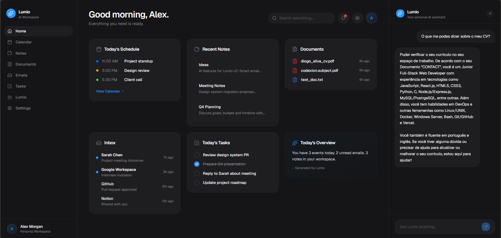
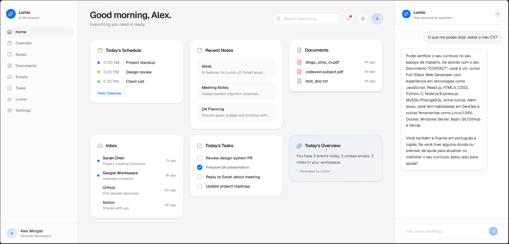

# Lumio

Your personal AI workspace: notes, documents, emails, and calendar in one place, with an intelligent RAG-powered assistant called Lumio.

> **Note:** this is a personal project and is still in development. You're welcome to use it, test it, and, if you're interested, contribute by submitting a PR.

Lumio brings your productivity apps together into one clean, Apple-inspired workspace. It centralizes your notes, documents, emails, and calendar, and pairs them with an AI assistant that answers questions, summarizes, and keeps you on top of your day.

[Watch Lumio here](https://sylvzzz.dev)

## Screenshots

| Dark | Light mode
| --- | --- | 
|  | 


## Features

- **Notes, documents, inbox, calendar and tasks** in a single workspace
- **AI assistant (RAG)** that answers questions about your own content, available as a side panel on every page
- **Settings page**
  - Profile: name, age and gender
  - Appearance: light, dark or system theme
  - Language: Portuguese or English, applied when you save
  - API key: choose your provider and update your key at any time
- **Local-first**: everything runs on your machine (ai model external - calling via Groq API) and your data stays in local files

## How it works

Lumio runs entirely on your computer. There is no database server: your data is stored in plain JSON files, so there is nothing to set up besides the app itself.

It is currently single-user, with no accounts or authentication. You can use it as your personal workspace, but it isn't designed to be shared between several people yet.

The workspace features (notes, documents, calendar, tasks) work out of the box. The **AI features need an API key** from OpenAI or Groq.

## Prerequisites

| Requirement | Version | Install |
|---|---|---|
| Git | any | [git-scm.com](https://git-scm.com/downloads) |
| Make | any | `apt install make` |
| Python | 3.11 | [python.org](https://www.python.org/downloads/) |
| Node.js + npm | 24 / 10 | [nodejs.org](https://nodejs.org/) |

## Getting started

### 1. Clone and install

```bash
git clone https://github.com/sylvzzz/Lumio.git
cd Lumio
make install
```

`make install` installs both the frontend and the backend dependencies.

### 2. Run

Start the backend and the frontend, each in its own terminal:

```bash
make dev-backend
```

```bash
make dev-frontend
```

Then open:

- Frontend: http://localhost:5173
- Backend API: http://localhost:8000

### 3. Add your API key (for the AI features)

You need a key from one of these providers:

- **Groq** (free tier): [console.groq.com/keys](https://console.groq.com/keys)
- **OpenAI**: [platform.openai.com/api-keys](https://platform.openai.com/api-keys)

You can add it in either of two ways:

1. **During onboarding**, the first time you open Lumio.
2. **In `backend/.env`**, for example:

   ```bash
   GROQ_API_KEY=your_key_here
   ```

You can also change it later in **Settings → API Key**. Without a key, the AI features stay disabled and the rest of the workspace keeps working.

## Commands

| Command | What it does |
|---|---|
| `make install` | Installs the frontend and backend dependencies |
| `make dev-backend` | Runs the backend |
| `make dev-frontend` | Runs the frontend |

## Tech stack

| Layer | Technology |
|---|---|
| Frontend | React, Vite, TypeScript, Tailwind CSS, shadcn/ui, Framer Motion, TanStack Query, React Router |
| Backend | Python 3.11 |
| Storage | Local JSON files |
| AI | Groq or OpenAI |


## Contributing

Contributions and Pull requests are more than welcome to improve the project :).